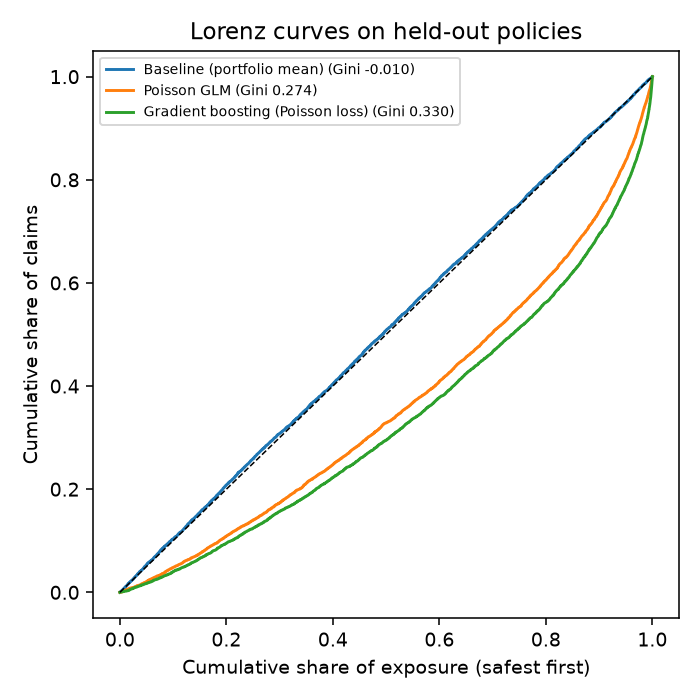
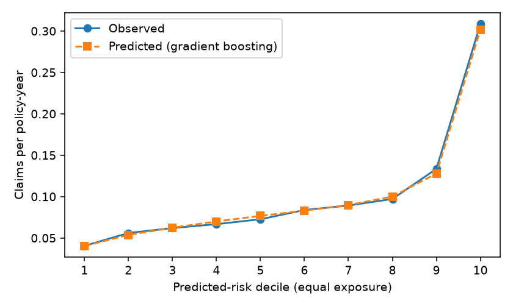

# claims-frequency-model

Predicts how often a motor insurance policy will claim, using the public
**freMTPL2freq** dataset: 678,013 French motor third-party liability policies,
a standard benchmark in actuarial machine learning. The workflow is the one an
actuarial pricing team uses for claim frequency: check the data in SQL, model
claims per policy-year with exposure as the weight, then compare models on
held-out policies.

```
OpenML ──► SQLite "policies" ──► SQL quality checks + capped "model_table" ──► train / test (75 / 25)
                                                                                 │
              baseline · Poisson GLM · gradient boosting (Poisson loss) ◄────────┘
                                   │
                       deviance · Gini · calibration ──► output/results.md, lorenz.png, calibration.png
```

## Results (held-out 169,504 policies)

| Model | Poisson deviance ↓ | Gini ↑ | Predicted / observed claims |
|---|---|---|---|
| Baseline (portfolio mean) | 0.6258 | −0.010 | 0.995 |
| Poisson GLM | 0.5962 | 0.274 | 0.992 |
| Gradient boosting (Poisson loss) | **0.5743** | **0.330** | 0.996 |

- Both models beat the baseline. Gradient boosting separates risks best: its
  riskiest 10% of exposure has 7.6× the claim frequency of its safest 10%
  (0.309 vs 0.041 claims per policy-year) and carries about 31% of all claims.
- It stays calibrated. Predicted frequency is within 0.004 of observed in
  every decile except the top two (within 0.007), and total predicted claims
  are within 0.5% of actual.
- The GLM is not far behind and is much easier to explain to a rating
  committee, since each factor is a multiplier. In practice I would show both:
  the GLM as the rating structure and the boosted model as a check on what it misses.




## Modelling choices

| Question | Choice | Why |
|---|---|---|
| Target | `claims / exposure`, weighted by `exposure` | A policy on the books for 3 months should count as a quarter of a policy-year |
| Loss | Poisson deviance | Claim counts are non-negative and rare; squared error suits neither |
| Bad records | Caps in SQL: claims at 4, exposure at 1 year, bonus-malus at 150 | 1,224 rows show > 1 year of exposure and 9 show 5–16 claims, which look like recording errors |
| GLM features | Ages binned into 10 quantile bands, `log(density)`, one-hot categoricals | A GLM is linear in log-frequency, so non-linear effects have to be built in |
| Boosted features | Raw numerics plus native categorical splits | Trees find thresholds and interactions on their own |
| Ranking metric | Exposure-weighted Gini from the Lorenz curve | Measures how well the model orders policies from safe to risky, which is what pricing needs |

The SQL step also produces a quick view of the strongest rating factor
(`output/results.md`): frequency rises from 0.082 at bonus-malus 50–59 to 0.312 at 100+.

## Monitoring the model after deployment

`monitor.py` treats the trained gradient-boosting model as if it were in production and scores three
simulated quarters of new policies. It writes `output/monitoring_report.json`, which a weekly GitHub
Actions job refreshes and commits.

| Check | What it catches | Alert rule |
|---|---|---|
| **Population stability index (PSI)** per input feature, against the training data | The book of business changing (younger drivers, a new region, a new vehicle brand) | ≥ 0.10 watch, ≥ 0.25 alert |
| **Actual / expected claims** once claims are in | The model's overall level going stale, e.g. claim frequency trending up | outside 0.90–1.10 |
| **Gini** on the new batch | The model ranking risks worse than at validation | below 80% of the validation Gini |

Poisson deviance is reported too, but not used for alerts: it rises on any riskier book even when the model is right.

| Simulated batch | What changed | Result |
|---|---|---|
| `steady` | Nothing (more of the same policies) | **ok**: A/E 0.988, every PSI < 0.001 |
| `mix_shift` | Younger, higher bonus-malus book | **watch**: PSI 0.62 on driver age and 0.42 on bonus-malus, but A/E stays 0.981, so the model still prices the new mix correctly |
| `claims_trend` | Same policies, 20% more claims | **alert**: inputs look normal (PSI < 0.001) but A/E is 1.204, so it needs retraining |

The point of keeping both checks: input drift alone does not mean the model is wrong (`mix_shift`), and a
model can go stale while every input looks normal (`claims_trend`).

### Weekly alert email (low-code, n8n)

[`automation/n8n/model-health-alert.json`](automation/n8n/model-health-alert.json) is an n8n workflow that
turns the report into an email for whoever owns the model:

```
Every Monday 10:00 ─► Fetch health report (HTTP) ─► Needs attention? ── no ─► Healthy, no alert
                                                         │ yes
                       One item per batch ─► Keep flagged batches ─► Build HTML table ─► Compose alert ─► Send email
```

It uses only built-in nodes (Schedule, HTTP Request, If, Split Out, Filter, HTML, Edit Fields, Send Email).
To use it, import the file in n8n (*Workflows → Import from file*), attach an SMTP credential to **Send email**,
set the recipient, and activate it.

`automation/n8n/test_n8n_workflow.py` runs the workflow in the n8n CLI against two local fixture reports.
On the alert report it checks that the email subject reads `Claims model: ALERT (2 batch(es) flagged)` and
that the table lists only the two flagged batches. On a healthy report it checks that the flow stops
without building an email. CI runs it on every push. The email node is removed for these runs, because
CI has no SMTP account.

```bash
npm install -g n8n
python -m unittest discover -s automation/n8n -v
```

[`docs/power-automate-alert.md`](docs/power-automate-alert.md) builds the same flow in Power Automate.

## Snowflake version of the pipeline

`snowflake/` runs the same data prep in Snowflake: `setup.sql` creates an auto-suspending XS warehouse,
database and schemas; `load_to_snowflake.py` loads the raw 678,013 policies with `write_pandas`, builds
`ANALYTICS.MODEL_TABLE` and the data-quality and bonus-malus views from `transform.sql`, then
**reconciles** row counts, claim totals and every quality check against the local SQLite pipeline and fails
if any differ.

```bash
pip install -r snowflake/requirements.txt
export SNOWFLAKE_ACCOUNT=... SNOWFLAKE_USER=... SNOWFLAKE_PRIVATE_KEY_PATH=~/.ssh/snowflake_key.p8
python snowflake/load_to_snowflake.py
```

Key-pair setup (one time): `openssl genrsa 2048 | openssl pkcs8 -topk8 -nocrypt -out ~/.ssh/snowflake_key.p8`,
`openssl rsa -in ~/.ssh/snowflake_key.p8 -pubout`, then in a Snowflake worksheet
`ALTER USER <you> SET RSA_PUBLIC_KEY='<key body without the BEGIN/END lines>';`.

## Run it

```bash
python3 -m venv .venv && source .venv/bin/activate
pip install -r requirements.txt
python -m unittest -v      # 12 tests: SQL prep, metrics, GLM recovering a known 3x rate, PSI, A/E, SQL files
python run.py              # downloads ~10 MB from OpenML on first run, ~20 s on a laptop
python monitor.py          # scores the simulated batches, writes output/monitoring_report.json
```

## Limits and next steps

- Frequency only. A full pure premium also needs claim severity (a Gamma or
  Tweedie model on freMTPL2sev).
- One train/test split. Cross-validated deviance and a confidence band on the
  Gini would make the model comparison firmer.
- The boosted model's hyperparameters were set by hand. A small tuning run and
  partial-dependence plots would be the next things to add.
- Monitoring batches are simulated from held-out policies; a real deployment would feed each quarter's
  new business and claims into the same checks.
